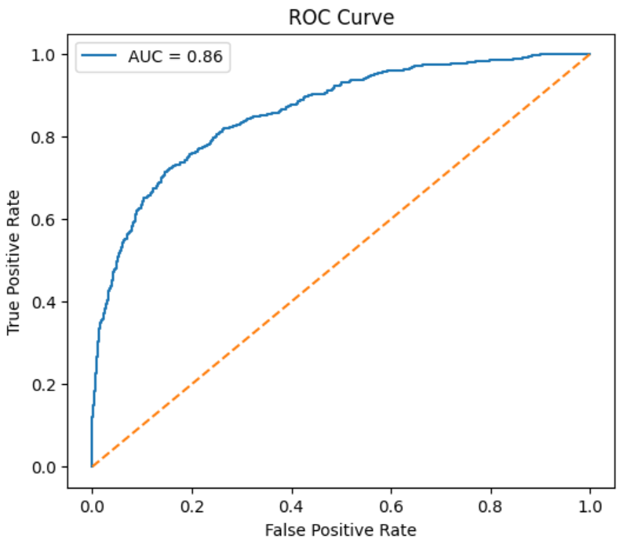
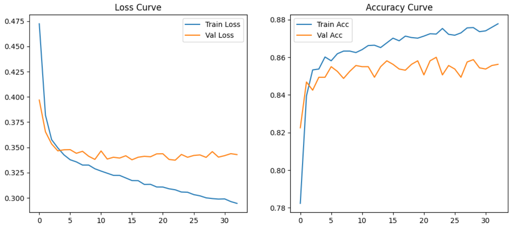

# Customer Churn Prediction using ANN & Modular ML Pipeline

  
  
  
  
  


An end-to-end Deep Learning project to predict bank customer churn using an Artificial Neural Network (ANN). The application features a production-style modular architecture separating data transformation (`ColumnTransformer`), inference pipeline (`PredictPipeline`), and interactive user interface (`Streamlit`), deployed on Hugging Face Spaces via Docker.

---

## 🌐 Live Demo

Access the live deployed application:  
👉 **[Hugging Face Space: Customer Churn Prediction ANN](https://huggingface.co/spaces/Aryan2301/Customer_Churn_Prediction_ANN)**

The web application allows users to interactively enter customer financial and demographic details to assess churn probability in real time.

---

## 📌 Problem Statement

Customer churn is a critical metric for banks. Retaining existing customers is significantly more cost-effective than acquiring new ones. The objective is to build a high-performance binary classification model that accurately identifies customers at high risk of leaving the bank (`Exited = 1`), enabling proactive retention strategies.

---

## 📊 Dataset Overview

* **Source**: Bank Customer Churn Dataset  
* **Total Samples**: 10,000  
* **Features**: 10 input attributes (demographic and financial)  
* **Target**: `Exited` (0 = Retained, 1 = Churned)

| Feature | Type | Description |
| :--- | :--- | :--- |
| `CreditScore` | Numerical | Credit score of the customer (300 - 900) |
| `Geography` | Categorical | Country of customer residence (`France`, `Germany`, `Spain`) |
| `Gender` | Categorical | Customer gender (`Female`, `Male`) |
| `Age` | Numerical | Age of the customer |
| `Tenure` | Numerical | Number of years with the bank (0 - 10) |
| `Balance` | Numerical | Account balance |
| `NumOfProducts`| Numerical | Number of bank products used (1 - 4) |
| `HasCrCard` | Binary | Whether the customer has a credit card (0 or 1) |
| `IsActiveMember`| Binary | Whether the customer is an active member (0 or 1) |
| `EstimatedSalary`| Numerical | Estimated annual salary |

---

## ⚙️ Modular Pipeline Architecture

To prevent train-serving skew and eliminate repetitive preprocessing code, the project uses a single unified **Scikit-Learn `ColumnTransformer`** and a decoupled **`PredictPipeline`**:

```
[User Input / Raw CSV]
          │
          ▼
┌────────────────────────────────────────────────────────┐
│               ColumnTransformer Pipeline               │
│  - StandardScaler: CreditScore, Age, Tenure, Balance,  │
│                    NumOfProducts, EstimatedSalary      │
│  - OrdinalEncoder: Gender (Female=0, Male=1)          │
│  - OneHotEncoder:  Geography (France, Germany, Spain) │
│  - Passthrough:    HasCrCard, IsActiveMember          │
└────────────────────────────────────────────────────────┘
          │ (12 Transformed Numerical Features)
          ▼
┌────────────────────────────────────────────────────────┐
│            Artificial Neural Network (ANN)             │
│  Input(12) ➔ Dense(64, ReLU) ➔ Dense(32, ReLU)        │
│             ➔ Dense(1, Sigmoid)                        │
└────────────────────────────────────────────────────────┘
          │
          ▼
[Churn Probability & Risk Classification]
```

### Key Architectural Advantages
1. **Zero Train-Serving Skew:** The same fitted `preprocessor.pkl` transforms both offline training batches and live single-row inference requests.
2. **Decoupled Frontend:** `streamlit_app/app.py` contains zero pandas slicing, column ordering, or scaling logic; it strictly handles UI rendering and user inputs.
3. **Reproducibility:** Re-fitting the pipeline can be executed in one click via `build_preprocessor.py`.

---

## 🧠 Model Architecture & Training

* **Input Dimension:** 12 features  
* **Hidden Layer 1:** 64 units, ReLU activation  
* **Hidden Layer 2:** 32 units, ReLU activation  
* **Output Layer:** 1 unit, Sigmoid activation (outputs probability $[0, 1]$)  
* **Loss Function:** Binary Cross-Entropy  
* **Optimizer:** Adam  
* **Evaluation Metrics:** Accuracy, Precision, Recall, ROC-AUC  

### Performance Summary
* **Accuracy:** ~86%  
* **ROC-AUC Score:** 0.86  

```text
              precision    recall  f1-score   support

           0       0.89      0.95      0.92      1607
           1       0.70      0.51      0.59       393

    accuracy                           0.86      2000
   macro avg       0.79      0.73      0.75      2000
weighted avg       0.85      0.86      0.85      2000
```

---

## 📈 Visualizations

| ROC Curve | Training Curves |
| :---: | :---: |
|  |  |

---

## 📁 Project Structure

```text
Customer_Churn_Prediction_ANN/
├── .gitignore                     # Git ignore rules for environments, caches & IDE files
├── Dockerfile                     # Docker container recipe for deployment
├── README.md                      # Comprehensive project documentation
├── requirements.txt               # Production Python dependencies
├── build_preprocessor.py          # Script to fit & serialize ColumnTransformer
│
├── Dataset/
│   └── Churn_Modelling.csv        # Raw customer churn dataset
│
├── artifacts/
│   └── preprocessor.pkl           # Serialized single ColumnTransformer pipeline
│
├── model/
│   └── model.h5                   # Trained Keras Artificial Neural Network
│
├── src/
│   ├── __init__.py
│   └── pipeline/
│       ├── __init__.py
│       └── predict_pipeline.py    # CustomData & PredictPipeline classes
│
├── streamlit_app/
│   └── app.py                     # Interactive Streamlit frontend UI
│
├── notebooks/
│   ├── customer-churn-prediction.ipynb # Training & exploratory analysis
│   └── prediction.ipynb                # Inference experiments
│
└── images/
    ├── roc_curve.png
    └── training_curve.png
```

---

## 🚀 Getting Started Locally

### 1. Clone the Repository
```bash
git clone https://github.com/Aryanupadhyay23/Customer_Churn_Prediction_ANN.git
cd Customer_Churn_Prediction_ANN
```

### 2. Create and Activate Virtual Environment
```bash
# Windows
python -m venv myenv
myenv\Scripts\activate

# Linux / macOS
python3 -m venv myenv
source myenv/bin/activate
```

### 3. Install Dependencies
```bash
pip install -r requirements.txt
```

### 4. (Optional) Rebuild the Preprocessor Pipeline
```bash
python build_preprocessor.py
```

### 5. Launch the Streamlit Web Application
```bash
streamlit run streamlit_app/app.py
```
Open your browser at `http://localhost:8501`.

---

## 🐳 Docker Deployment

You can build and run the application container locally:

```bash
# Build Docker image
docker build -t churn-prediction-ann .

# Run Docker container
docker run -p 7860:7860 churn-prediction-ann
```
Navigate to `http://localhost:7860` to access the application.

---

## 💡 Key Takeaways

* **Pipeline Engineering:** Combining `StandardScaler`, `OrdinalEncoder`, and `OneHotEncoder` into a single `ColumnTransformer` simplifies downstream code and eliminates transformation bugs.
* **Separation of Concerns:** Encapsulating feature serialization and inference inside a dedicated `PredictPipeline` makes deployment interfaces (Streamlit, FastAPI, Flask) interchangeable.
* **Neural Network Serving:** Efficiently serving Keras models with lazy-loading and Streamlit `@st.cache_resource` for low-latency web inference.